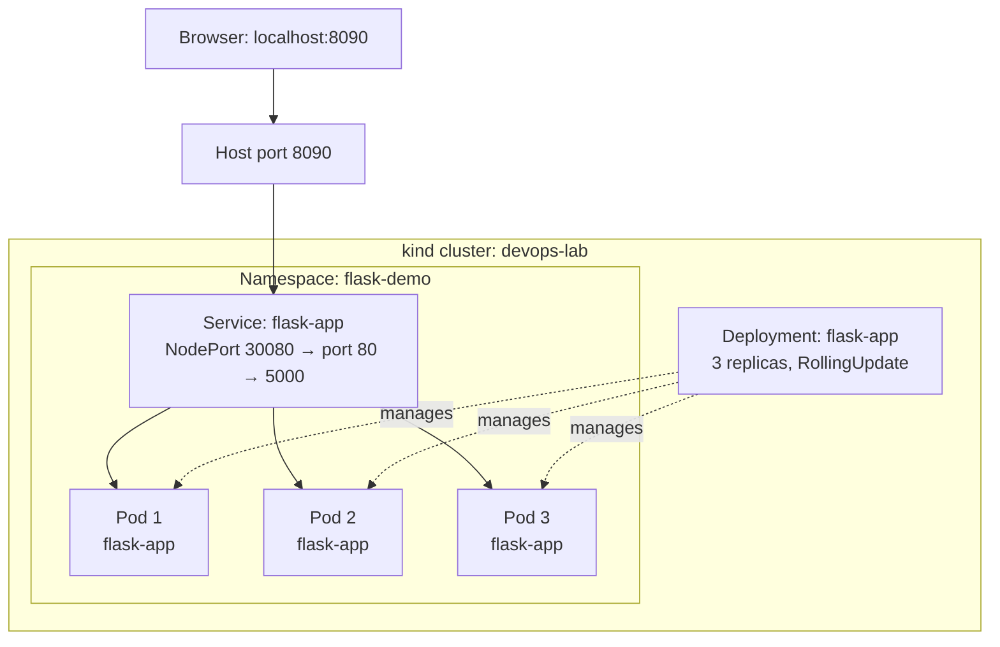
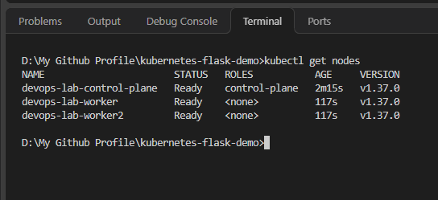
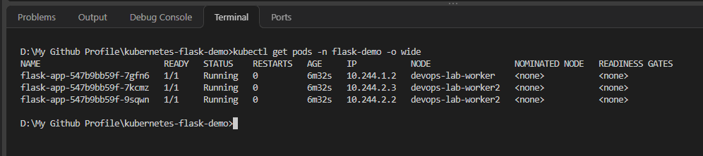
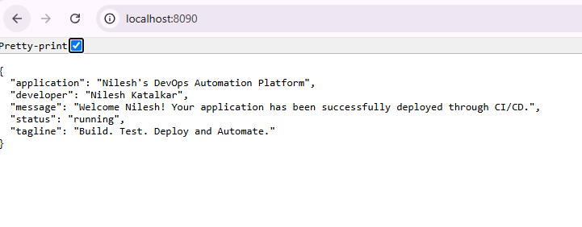
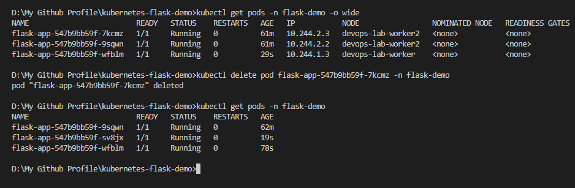
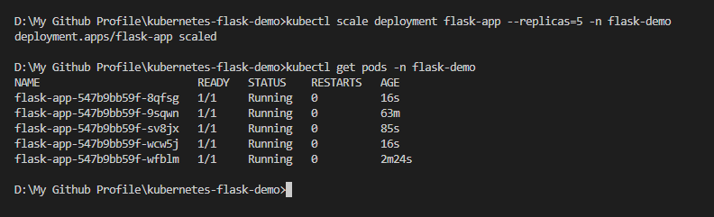
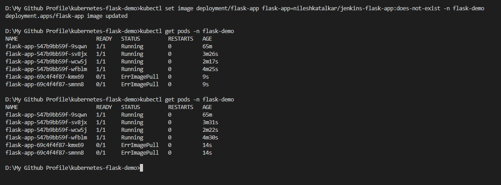
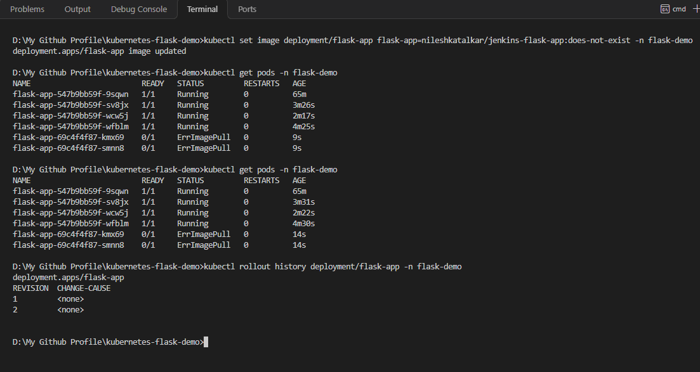

# Kubernetes Deployment: Flask App on a Local kind Cluster

A Flask application deployed to a local multi-node Kubernetes cluster built with [kind](https://kind.sigs.k8s.io/). The project covers 3 replicas, health probes, resource limits, self-healing, scaling, rolling updates, and rollbacks. It runs entirely on a laptop with Docker, with no cloud account.

The container image comes from my Jenkins pipeline project: [jenkins-pipeline-demo](https://github.com/nileshkatalkar/jenkins-pipeline-demo).

## Architecture



| Component | Details |
|-----------|---------|
| Cluster | kind, 1 control-plane node and 2 worker nodes |
| Namespace | `flask-demo` |
| Deployment | `flask-app`, 3 replicas, rolling update (`maxUnavailable: 1`, `maxSurge: 1`) |
| Service | NodePort `30080`, forwards port 80 to container port 5000 |
| Probes | Readiness and liveness checks on `/health` |
| Resources | Requests `50m` CPU / `64Mi` memory, limits `200m` / `128Mi` |
| Image | `nileshkatalkar/jenkins-flask-app` (tags `1`, `2`, `latest`) |

## Project structure

```
kubernetes-flask-demo/
├── kind-config.yaml        # Cluster definition: 1 control plane, 2 workers, port mapping
├── k8s/
│   ├── namespace.yaml      # flask-demo namespace
│   ├── deployment.yaml     # 3 replicas, probes, resources, rolling update strategy
│   └── service.yaml        # NodePort service
├── docs/                   # Screenshots used in this README
└── README.md
```

## Prerequisites

- Docker Desktop running
- [kind](https://kind.sigs.k8s.io/docs/user/quick-start/#installation)
- [kubectl](https://kubernetes.io/docs/tasks/tools/)

## Run it

### 1. Create the cluster

```bash
kind create cluster --name devops-lab --config kind-config.yaml
kubectl get nodes
```

Expect one control-plane node and two workers, all `Ready`. The cluster maps host port **8090** to node port **30080**.

### 2. Deploy the application

```bash
kubectl apply -f k8s/namespace.yaml
kubectl apply -f k8s/
kubectl get all -n flask-demo
kubectl get pods -n flask-demo -o wide
```

When all three pods show `Running` and `1/1`, open http://localhost:8090.

If your network blocks image pulls from inside the cluster, load the image from your machine instead:

```bash
docker pull nileshkatalkar/jenkins-flask-app:1
kind load docker-image nileshkatalkar/jenkins-flask-app:1 --name devops-lab
```

The deployment uses `imagePullPolicy: IfNotPresent`, so it will use the loaded copy.

## What I tested

### Self-healing

Delete a pod and Kubernetes replaces it automatically:

```bash
kubectl delete pod <pod-name> -n flask-demo
kubectl get pods -n flask-demo -w
```

### Scaling

```bash
kubectl scale deployment flask-app --replicas=5 -n flask-demo
kubectl get pods -n flask-demo
kubectl scale deployment flask-app --replicas=3 -n flask-demo
```

### Rolling update

Switch to version 2 of the image with no downtime:

```bash
kubectl set image deployment/flask-app flask-app=nileshkatalkar/jenkins-flask-app:2 -n flask-demo
kubectl rollout status deployment/flask-app -n flask-demo
kubectl rollout history deployment/flask-app -n flask-demo
```

### Rollback

```bash
kubectl rollout undo deployment/flask-app -n flask-demo
```

### A failed release

I deployed an image tag that does not exist to see how Kubernetes handles a bad release:

```bash
kubectl set image deployment/flask-app flask-app=nileshkatalkar/jenkins-flask-app:does-not-exist -n flask-demo
kubectl get pods -n flask-demo
```

The new pods went into `ErrImagePull` and `ImagePullBackOff`, **while the old pods kept running and serving traffic**. The readiness probe and the rolling update strategy stopped the bad version from replacing the healthy one. `kubectl rollout undo` then restored the previous version.

## Screenshots

<!-- Save your screenshots in the docs/ folder with these names -->

**Cluster nodes: 1 control plane and 2 workers**



**Pods running across the worker nodes**



**App served through the Service on port 8090**



**Self-healing: a deleted pod being replaced**



**Scaling from 3 to 5 replicas**



**Failed release: new pods stuck in ErrImagePull while old pods keep serving**



**Rollout history after the update and rollback**



## Problems I hit and how I solved them

| Problem | Cause | Fix |
|---------|-------|-----|
| Cluster creation failed with `port is already allocated` | Host port 8080 was already used by other containers on my machine | Changed the host port in `kind-config.yaml` to 8090 |
| Pods in `ErrImagePull` | The image tag did not exist or could not be pulled through my network's firewall | Used `kubectl describe pod` to read the events, then rolled back or loaded the image with `kind load docker-image` |
| Deleting a failing pod did not fix it | The Deployment recreates deleted pods from the same broken template | Fixed the Deployment itself (rollback or correct image), not the individual pod |

## What I learned

- How Pods, Deployments, Services, and Namespaces fit together
- Readiness versus liveness probes, and why readiness protects users during a release
- How resource requests and limits control scheduling and stop one pod from using everything
- How a rolling update replaces pods gradually, and how a rollback restores the last good version
- Debugging with `kubectl describe`, `kubectl logs`, and cluster events

## Possible improvements

- Add a Horizontal Pod Autoscaler (HPA) with metrics-server
- Add a ConfigMap and Secret for configuration
- Add an Ingress controller instead of a NodePort
- Deploy with Helm or Kustomize
- Add a GitHub Actions or Jenkins stage that applies the manifests automatically
- Run the same manifests on a managed cluster such as Amazon EKS

## Clean up

```bash
kind delete cluster --name devops-lab
```

## Author

**Nilesh Katalkar**
[LinkedIn](https://linkedin.com/in/nilesh-katalkar-984385195/) · [GitHub](https://github.com/nileshkatalkar)
